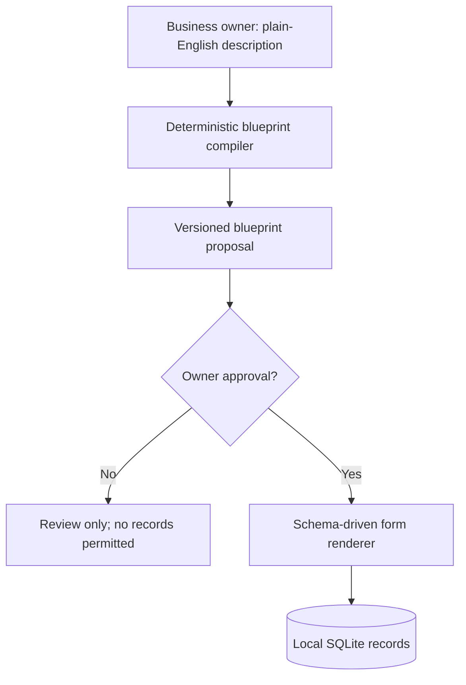

# Moduvela — personalised business software, shaped by a conversation

**Status: independent proof of concept, v0.2 development.** Moduvela proposes a usable business application blueprint from a business owner's plain-English description. After explicit approval, it displays working forms and stores records in SQLite.

The initial release uses a transparent **rule-based compiler**, not a hosted AI model. This is intentional: it is genuinely runnable offline, asks for no credentials, makes no outbound requests and avoids claiming unrestricted generative AI functionality. It offers starting templates for garages, auditors, salons and a generic service business, or a **fully manual starting point from scratch** with your own first section and fields.

> **Use fictional data only.** No authentication or production-grade data protection exists in v0.1.

## Run in 30 seconds

Requires Python 3.10 or newer. No package installation necessary.

```bash
python -m unittest discover -s tests -v
python -m moduvela.server
```

Open **http://127.0.0.1:8765** in the same computer's browser. You can change the listening port using the `MODUVELA_PORT` environment variable.

## What you can try

1. Describe a fictitious business: "I run a garage. Mechanics repair cars, we order parts and invoice customers."
2. Review the proposed entities and fields.
3. Click **Approve and activate**.
4. Before approval, add custom business sections or additional fields through the local browser; no AI is needed.
5. Add fictional customer, vehicle and job records through the generated forms.
6. Search records, edit a record, review the deletion confirmation, and export an entity as CSV or the whole approved application as JSON.
7. Restart the server: data is stored in `moduvela.db`, and the homepage lists up to 20 recent proposals.

## No-AI-first functionality (v0.2 development)

- **Manual setup from scratch:** choose application name, first business section and fields; no template matching or LLM.
- **Editable records:** view, search, update and delete fictional records in approved blueprints.
- **Data export:** spreadsheet-conscious CSV export (formula-like cells neutralised) and exact-text JSON snapshots (export only; JSON import and restore are not yet implemented).
- **Offline:** Python standard library and SQLite, loopback-only browser interface; nothing is sent to a cloud service.
- **Limitations:** all fields are still text; no authentication, fine-grained role permissions, audit trail, undo, reliable backups or safe multi-user hosting. Deletion is permanent.

## Architecture



See [architecture](docs/ARCHITECTURE.md), [roadmap](docs/ROADMAP.md), [contribution guide](CONTRIBUTING.md) and [security notice](SECURITY.md).

## Security and scope

- Loopback-bound demo server (`127.0.0.1`), not internet-facing hosting.
- A random per-process form token reduces accidental cross-site POSTs, but **does not replace authentication**.
- Fixed entity/field identifiers, validation, parameterised SQL and HTML escaping.
- No external providers, AI API calls, credentials, business integrations or analytics.
- **No login, user separation, backups, encryption-at-rest, data migration, RBAC or production-grade privacy controls yet.** Do not use real personal, employee, business or payment data.
- The HTTP server deliberately handles requests sequentially so its single SQLite connection is not shared across request threads. This is a single-user demonstration, not a scalable service.

## Brand, ownership and licence

**Moduvela is a provisional working name.** No trademark clearance, company registration or domain availability is implied by this repository. Conduct UKIPO/WIPO trademark and domain checks before commercial launch.

MIT licence (see [LICENSE](LICENSE)). This permits others to use, copy and commercially modify the source. It does not protect the business concept from competition; trademarks and commercial services are separate considerations.

Built with entirely original, fictional scenarios and data; no employer or customer materials.

## Core principle: non-AI first

The **application runtime is the product**, and it must perform everyday work without any model, token, cloud subscription or network connection. AI may later help translate descriptions into suggested, owner-approved blueprints, but business records, policies, workflows and reports are computed by a deterministic engine. See [architecture decision ADR-0001](docs/ADR-0001-LOCAL-FIRST-CORE.md) and [the local-first roadmap](docs/ROADMAP.md).

The current prototype has no authentication and is **for fictional demo data only**. Many advertised roadmap capabilities are not yet implemented.

## AI cost policy

**Free trials never call paid AI APIs at Moduvela's expense.** The main product is the offline, deterministic application engine. Any future optional inference will be either customer-funded through bring-your-own-key (BYOK), prepaid hosted AI credits, or a compatible customer-owned local model. AI is not needed for ordinary business operations. See [ADR-0002: zero-subsidy AI](docs/ADR-0002-AI-COST-POLICY.md).

## Experimental tiny browser-based MicroAI

For customers who want to **describe** a business instead of filling in a guided wizard, see [the MicroAI experiment](experiments/microai/README.md) and its [browser demonstration](experiments/microai/index.html).

MicroAI v0 is a domain-specific **weighted nearest-example text classifier**, not a language model. It recognises some business concepts and proposes Moduvela version-1 fields; it does not create arbitrary applications or run workflows. It requires no AI provider, model download, GPU, or inference service. The classifier is completely optional, with all production-facing capabilities remaining in the deterministic non-AI engine.

Run the standalone static demonstration locally with `python -m http.server 8000 --bind 127.0.0.1` and open `http://127.0.0.1:8000/experiments/microai/`. Its suggestions are experimental and are not automatically applied to the main runtime.

## MicroAI integrated Blueprint Designer (experimental)

Open **[http://127.0.0.1:8765/microai/](http://127.0.0.1:8765/microai/)** while the local server is running. It provides browser-only requirement interpretation, evidence-backed suggested sections, an editable selection, questions about ambiguous workflow requirements, and an explicit **Save as draft** action. The local server validates this draft and requires separate approval before records can be created. Neither a model download nor paid AI API calls are needed. The current prototype is **not** an AI-generated working workflow engine: relationships and conditional approvals are unimplemented suggestions.

See [MicroAI quality and limitations](docs/MICROAI-QUALITY.md). Use fictional data only.

## MicroAI v0.4: human correction and field suggestions

The local Blueprint Designer now supports **editing an application name, renaming suggested sections, editing comma-separated field names, selecting/removing sections and adding new custom sections**. The offline field extractor suggests a few explicitly mentioned attributes (such as `serial_number`, `warranty_date`, `repair_cost`, `customer_email`), or asks a question when its destination is ambiguous. The preview is validated locally; the Python server validates it again and accepts it **only as an unapproved draft**. No AI API requests, model downloads or executable generated workflows are involved. See [MicroAI quality guide](docs/MICROAI-QUALITY.md).

## New research pipeline and executable local state machines

MicroAI now includes a **supervised trained** CPU-only, 8 KB-weights multi-label classifier in the browser. It is an *advisory* side-by-side comparison, because it currently performs worse than deterministic business-term rules on synthetic held-out data. Its training corpus and all scripts are committed and reproducible: see [dataset policy](docs/MICROAI-DATASET.md) and [blueprint contracts](docs/BLUEPRINT-CONTRACTS.md). Artificial examples are **not independent real-world validation**.

A separate local deterministic runtime now supports explicitly activated **state-machine workflows** and **record-to-record links**. For a fictional approved app with Jobs and Customers, configure status stages and a Jobs.customer link from the corresponding links on its application page. Unsupported manager approvals are still unimplemented, and no login or production security exists. Use fictional data only.
