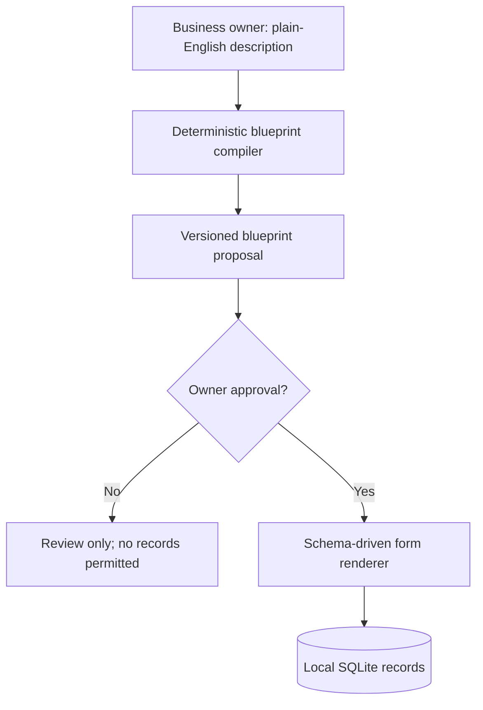

# Moduvela — personalised business software, shaped by a conversation

**Status: independent proof of concept, v0.2 development.** Moduvela proposes a usable business application blueprint from a business owner's plain-English description. After explicit approval, it displays working forms and stores records in SQLite.

The initial release uses a transparent **rule-based compiler**, not a hosted AI model. This is intentional: it is genuinely runnable offline, asks for no credentials, makes no outbound requests and avoids claiming unrestricted generative AI functionality. It supports initial business templates for garages, auditors, salons and a generic service business.

> **Use fictional data only.** No authentication or production-grade data protection exists in v0.1.

## Run in 30 seconds

Requires Python 3.10 or newer. No package installation necessary.

```bash
python -m unittest discover -s tests -v
python -m moduvela.server
```

Open **http://127.0.0.1:8765** in the same computer's browser. You can change the listening port using the `MODUVELA_PORT` environment variable.

## What you can try

1. Describe a fictitious business: "I run a garage. Mechanics repair cars, we order parts and invoice customers."
2. Review the proposed entities and fields.
3. Click **Approve and activate**.
4. Before approval, add custom business sections or additional fields through the local browser; no AI is needed.
5. Add fictional customer, vehicle and job records through the generated forms.
6. Restart the server: data is stored in `moduvela.db`, and the homepage lists up to 20 recent proposals.

## Architecture



See [architecture](docs/ARCHITECTURE.md), [roadmap](docs/ROADMAP.md), [contribution guide](CONTRIBUTING.md) and [security notice](SECURITY.md).

## Security and scope

- Loopback-bound demo server (`127.0.0.1`), not internet-facing hosting.
- A random per-process form token reduces accidental cross-site POSTs, but **does not replace authentication**.
- Fixed entity/field identifiers, validation, parameterised SQL and HTML escaping.
- No external providers, AI API calls, credentials, business integrations or analytics.
- **No login, user separation, backups, encryption-at-rest, data migration, RBAC or production-grade privacy controls yet.** Do not use real personal, employee, business or payment data.
- The HTTP server deliberately handles requests sequentially so its single SQLite connection is not shared across request threads. This is a single-user demonstration, not a scalable service.

## Brand, ownership and licence

**Moduvela is a provisional working name.** No trademark clearance, company registration or domain availability is implied by this repository. Conduct UKIPO/WIPO trademark and domain checks before commercial launch.

MIT licence (see [LICENSE](LICENSE)). This permits others to use, copy and commercially modify the source. It does not protect the business concept from competition; trademarks and commercial services are separate considerations.

Built with entirely original, fictional scenarios and data; no employer or customer materials.

## Core principle: non-AI first

The **application runtime is the product**, and it must perform everyday work without any model, token, cloud subscription or network connection. AI may later help translate descriptions into suggested, owner-approved blueprints, but business records, policies, workflows and reports are computed by a deterministic engine. See [architecture decision ADR-0001](docs/ADR-0001-LOCAL-FIRST-CORE.md) and [the local-first roadmap](docs/ROADMAP.md).

The current prototype has no authentication and is **for fictional demo data only**. Many advertised roadmap capabilities are not yet implemented.
