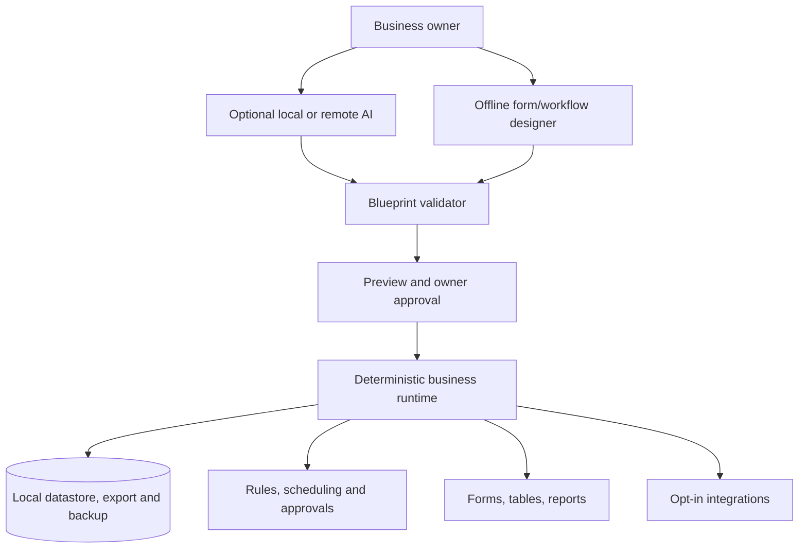

# ADR-0001: A deterministic local-first business application engine

## Status
Accepted as product direction (October 2026); implementation is incremental.

## Context
Small businesses need software that adapts to their work. Remote AI-generated apps and fragile custom code introduce unnecessary operating cost, data exposure and maintenance risks. We want a platform where everyday business functions can run locally without any model, API key, subscription or internet.

## Decision
Build one versioned, declarative **business application runtime**. A blueprint defines data objects, fields, relationships, screens, permissions, rules, state machines, jobs and reports. The engine validates and executes that blueprint using deterministic, tested code.

**Core works without AI:**
1. Form and data modeller: typed fields, defaults, required/unique, relationships, calculated fields and validation.
2. Record management: create/read/update/delete, lists, filtering, search, sorting, import/export, backup/recovery.
3. Workflow builder: state transitions, approvals, assignments, deadlines, escalations and deterministic rules.
4. Business operations: templates, dashboards, charts, reports, reminders and permitted notifications.
5. Security and identity: user management, tenant separation, RBAC, auditable history, safe secrets.
6. Distribution: local desktop, self-hosted and managed deployments with documented portability.
7. Integration adapters: explicitly configured connectors and event hooks with permissions and audit.

**Optional AI only:** Interpret a description into a *draft* blueprint; suggest fields, workflows and reports; explain configuration. AI responses must pass versioned schema checks, permission/policy checks, tests and owner approval. AI never directly executes code, modifies data, changes permissions or bypasses deployment gates.

## Logical architecture

## Quality constraints
- All core tests must pass with no AI SDK, API key or internet.
- AI may create proposals only; there is no direct unrestricted generation/execution of arbitrary runtime source.
- Schema upgrades require explicit migration plans, backups and rollback/restore validation.
- Policy enforcement must live in the runtime, not only in generated UI controls.
- Standalone/offline use and multi-user synchronisation are different problems. Multi-user sync requires conflict handling and secure identity, not merely an offline cache.
- Do not use sensitive real customer data in the current prototype: authentication, tenant isolation, encryption-at-rest and production-grade backup are missing.
- Export and exit must be available without a licence or hosted subscription.
- Built-in plugins/integrations need least-privilege credentials and no silent external transfers.

## Alternatives considered
- AI-generated custom code for every customer: attractive demos, poor consistency and maintenance.
- Only hosted no-code SaaS: easier operations, weak local-ownership promise.
- Versioned declarative engine, optional AI (chosen): significant up-front engine work but reusable assurance.

## Consequences
The engine is the product; optional AI is a convenience layer. We prioritise reusable workflow and data primitives over large numbers of hard-coded industry modules. Business logic remains transparent and inspectable.

## Verification
Demonstrate a fully custom application without AI; replayable workflows; protected cross-user access; backup/restore and export/import round trips; regression tests for blueprint migrations. Record measured results, not aspirational claims.
