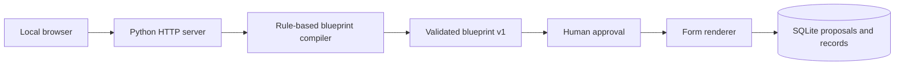

# Moduvela architecture — v0.1

## Purpose

Convert a short business description into a structured, versioned proposal for a small operational application. The first release **does not** generate arbitrary source code or invoke an LLM.

## Components

- **Compiler**: picks a predefined template from visible keyword mappings.
- **Validator**: accepts only version 1 with constrained entity and field identifiers.
- **Approval**: required before record entry; not an authentication control.
- **Renderer**: produces forms and escapes displayed text.
- **Storage**: JSON record payloads stored in local SQLite alongside approved proposals.
- **Server**: loopback-only and single threaded to avoid concurrent SQLite connection use.

## Trust and threat assumptions

Assumes a single trusted local operator in a nonproduction environment with synthetic data. No access control exists for other local processes/users capable of contacting the loopback port. A hostile user, shared workstation or browser extension is outside the initial threat model.

## Future target

A versioned declarative application model, per-tenant isolation, schema change planning, deterministic migration/rollback, permission enforcement, audit history, accessible UI controls, and optional provider-agnostic AI-assisted blueprint suggestions with explicit consent. The declarative engine should reject unsupported or unsafe generated policies.

See [roadmap](ROADMAP.md).
